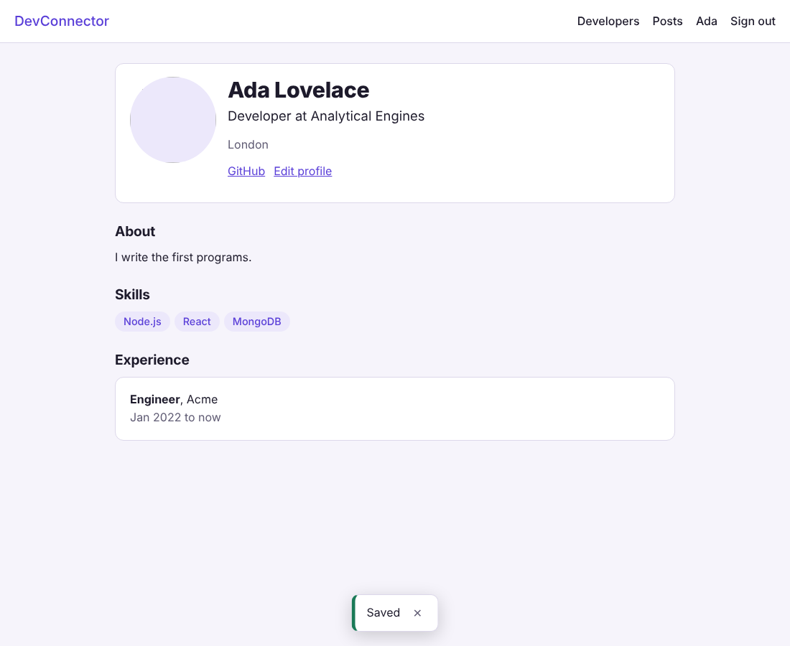

# DevConnector

[](https://github.com/yakshi0046/dev-connector/actions/workflows/ci.yml)

A social network for developers. Create an account, build a profile with experience, education and skills, show your latest GitHub repositories, and share posts with likes and comments.

**Live demo:** https://YOUR-APP.vercel.app (the API is on free hosting, so the first load can take about a minute)



## Features

- **Authentication:** register and sign in with JWT bearer tokens and bcrypt-hashed passwords. Rate limiting on the auth routes.
- **Profiles:** create and edit a profile, add and remove experience and education, browse all developers, view a public profile.
- **GitHub integration:** a profile with a GitHub username shows the five most recent repositories, fetched through the API.
- **Posts:** create posts, like and unlike, comment, and delete your own posts. Post owners can also remove comments on their posts.
- **Account deletion:** removes the profile, the posts, and the user's likes and comments everywhere.

## Tech stack

| Layer | Choices |
|---|---|
| API | Node.js, Express, MongoDB, Mongoose, express-validator, helmet, jsonwebtoken, bcryptjs |
| UI | React 18, Redux Toolkit, React Router, Axios, Vite, plain CSS with light and dark themes |
| Tests | Jest and Supertest against a real MongoDB |
| CI | GitHub Actions with a MongoDB service container |

## Project structure

```
server/   Express API: routes, Mongoose models, middleware, tests
client/   React app: Redux slices in src/features, screens in src/components
```

## API

| Method and path | Auth | Purpose |
|---|---|---|
| `POST /api/auth/register` | no | Create an account, returns a token |
| `POST /api/auth/login` | no | Sign in, returns a token |
| `GET /api/auth/me` | yes | Current user |
| `GET /api/profile` | no | All profiles |
| `GET /api/profile/user/:userId` | no | One profile |
| `GET /api/profile/me` | yes | Own profile |
| `POST /api/profile` | yes | Create or update own profile |
| `DELETE /api/profile` | yes | Delete account, profile and posts |
| `PUT /api/profile/experience`, `PUT /api/profile/education` | yes | Add an entry |
| `DELETE /api/profile/experience/:id`, `DELETE /api/profile/education/:id` | yes | Remove an entry |
| `GET /api/profile/github/:username` | no | Latest GitHub repositories |
| `GET /api/posts`, `GET /api/posts/:id` | yes | Read posts |
| `POST /api/posts`, `DELETE /api/posts/:id` | yes | Create, delete own post |
| `PUT /api/posts/like/:id`, `PUT /api/posts/unlike/:id` | yes | Like, unlike |
| `POST /api/posts/comment/:id`, `DELETE /api/posts/comment/:id/:commentId` | yes | Comment, delete comment |

## Run locally

Requirements: Node 18+ and a MongoDB database (a local install, Docker, or a free MongoDB Atlas cluster).

```bash
# 1. API (http://localhost:5000)
cd server
cp .env.example .env        # then edit MONGO_URI and JWT_SECRET
npm install
npm run dev

# 2. UI (http://localhost:5173), in a second terminal
cd client
npm install
npm run dev
```

Quick MongoDB with Docker: `docker run -d -p 27017:27017 mongo:7`.

Run the API tests (they use the database `devconnector_test` and clear it): `cd server && npm test`.

## Deploy

1. **Database:** create a free cluster on MongoDB Atlas, add a database user, allow network access from anywhere (`0.0.0.0/0`), and copy the connection string.
2. **API on Render:** New > Web Service > connect this repo > Root directory `server` > Build command `npm install` > Start command `npm start` > Instance type Free. Add the environment variables `MONGO_URI`, `JWT_SECRET` (a long random string) and, once the UI exists, `CLIENT_ORIGIN` (the Vercel URL, no trailing slash). Set the health check path to `/api/health`.
3. **UI on Vercel:** Import the repo > Root directory `client` > Framework Vite. Add `VITE_API_URL` with the Render URL (no trailing slash), then deploy.
4. Set `CLIENT_ORIGIN` on Render to the Vercel URL and let it redeploy.

## Design notes

- **Mass assignment is blocked.** The profile endpoint writes only whitelisted fields, so a client cannot overwrite the owner, experience or education through it.
- **Likes are atomic.** A single conditional update prevents double likes even with rapid clicks.
- **Consistent errors.** Validation failures return the field and message, and the UI turns them into toasts.
- **Expired tokens** sign the user out automatically.
- **Passwords** are never selected from the database by default and never returned.

## Limitations and ideas

- No email verification or password reset.
- Posts are not paginated.
- Tokens are kept in `localStorage`. HttpOnly cookies would be the next hardening step.

## License

MIT
